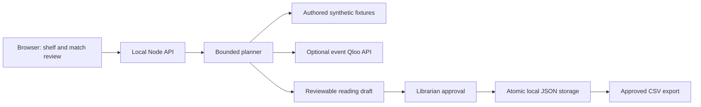

# SecondShelf

A library discovery tool that turns volunteered film, artist and book favourites into a librarian-approved reading list **from stock that is actually available**.

Public MIT source: [Vcode2407/qloo-secondshelf](https://github.com/Vcode2407/qloo-secondshelf). [Automated local checks](https://github.com/Vcode2407/qloo-secondshelf/actions) run on Windows and Ubuntu; controlled provider responses do not verify live Qloo.

The [hosted Worker source and setup](hosting/README.md) reproduce the same workflow with browser-local saved lists, signed reviewed-state capsules, D1 draft-state checks and bounded public-demo quotas. The repaired build was successfully deployed at https://secondshelf-library.viku355.chatgpt.site on October 11, 2026; its first deployment was October 10. An actual private cloud check passed resolution, planning, refinement, approval and stale/repeated-approval rejection. See [deployment evidence](docs/HOSTED_EVIDENCE.md) and the [dependency review](hosting/SECURITY.md). Its audience remains **owner-private**; a private deployment does not meet Qloo's public-demo requirement. No event key or live Qloo result is verified yet.

The local application works end to end without an account or API key. Its default sample mode uses authored fixtures and synthetic tag overlap. **Those matches, scores and rankings are not Qloo data.** A real Qloo adapter is implemented separately and requires an event credential plus an explicit choice of Qloo mode. No live provider calls have been verified, and this local build is **not yet a qualifying hackathon submission**.

## Run on Windows

Install Node.js **22.19.0 or newer**, open PowerShell in this directory, then run:

```powershell
npm ci
npm test
npm start
```

Open [http://127.0.0.1:4182](http://127.0.0.1:4182). The local Node application has no external package dependencies, remote fonts or images; the separate hosted build has its own pinned dependencies. `npm ci` consumes the root lockfile. Stop the server with Ctrl+C. `npm run check` checks JavaScript syntax. `npm run dev` restarts the server after source changes.

## A useful workflow now

1. Search or filter the sample library catalogue. Compare **one to six available titles**; zero-copy books cannot enter a plan.
2. Enter **one to three favourites**, with the correct movie, artist or book category. The sample briefing uses Interstellar and David Bowie. Other supported sample favourites include Spirited Away, Taylor Swift, Knives Out and the catalogue book titles.
3. Review entity matches. Every favourite must have a reviewed match. Unknown names stay unresolved; edit them instead of silently accepting a fabricated ID. A catalogue title can be omitted. The sample-only “Accept displayed sample matches” button is an explicit action and never appears for real Qloo matches.
4. Prepare a reading draft. Each sample recommendation shows its synthetic tag-fit evidence; a live recommendation shows actual Qloo result order and any returned affinity.
5. Exclude a book, choose a category or change the list size. Refine the draft and review the replacement. Superseded drafts cannot be approved. Pending exclusions must be refined before approval.
6. Approve as the librarian and download CSV or the full saved evidence JSON. Reopen an approved list with **Review saved evidence**. Reviewed identities, entered queries, request IDs, result order and evidence trails persist across restarts. This saves a local reading list; it **does not reserve books, change stock, identify a patron or contact anyone**.

See [DEMO.md](DEMO.md) for a short walkthrough and failure cases.

## Connect real Qloo access

The participant approved the two required agreements, and the official hackathon key-request form confirmed receipt on **October 10, 2026**. An issued key is still pending. Keys are manually provisioned, usually within a few business days. New participants can request access through the [official developer guide](https://docs.qloo.com/reference/qloo-llm-hackathon-developer-guide). No live sponsor access is assumed.

```powershell
Copy-Item .env.example .env
```

Edit `.env` locally to set `QLOO_API_KEY`, then restart `npm start`. Do not put the key in the browser, source, chat, a video or a public repository. The `.env` and `data/` directories are ignored by Git.

The UI continues to default to sample mode even when a credential is configured. Choose **Qloo · live event API**, then press **Resolve with Qloo & review** to initiate calls. Configured status is not proof of a live connection. Search uses:

```text
GET https://hackathon.api.qloo.com/search
X-Api-Key: <backend credential>
query=<name>&types=urn:entity:movie|artist|book&take=3
```

Review returned candidate names and editions individually. A search candidate must declare the selected entity type. Different shelf books cannot map to the same Qloo UUID; ambiguous mappings are rejected before insights. The planner retains the chosen ID, name and type separately from the entered query, then uses only those reviewed entity IDs:

```text
GET https://hackathon.api.qloo.com/v2/insights
X-Api-Key: <backend credential>
filter.type=urn:entity:book
signal.interests.entities=<reviewed favourite IDs>
filter.results.entities=<reviewed available catalogue IDs>
take=6
```

The [book parameter guide](https://docs.qloo.com/reference/available-parameters-by-entity-type) supports both filters. [Search](https://docs.qloo.com/reference/get-search) and [Insights](https://docs.qloo.com/reference/insights-api-deep-dive) have distinct purposes. Hackathon keys do not work against the production or staging hostname; legacy `/recommendations` and `/recs` are not used.

Resolution performs at most **9 searches** (3 favourites + 6 catalogue books), with 8-second per-call deadlines and an approximately 30-second aggregate limit. Draft preparation or explicit refinement performs one insights request. There is no automatic polling, retry, paid LLM call or live-call fallback. Actual provider errors, unknown/duplicate returned catalogue IDs, malformed responses and empty results stop the action with a recoverable message. They never become synthetic “Qloo” results. Numeric event quota limits and eventual entity coverage need verification with the issued key.

## How the agentic workflow operates

The deterministic orchestrator executes resolution → human match review → available-inventory grounding → ranking → refinement → librarian approval → export. A retained resolution expires after 30 minutes. The backend validates choices against the exact offered candidates rather than trusting browser-supplied entity IDs. The live adapter preserves Qloo response order rather than sorting or inventing a score. This build does **not** use an LLM or claim natural-language model reasoning; Qloo's rules permit an agentic-tool path.



The saved evidence includes the normalized search candidates, reviewed selection, insights request parameters, provider request ID and all normalized insights entities in the actual response order, including results beyond the displayed list limit. Each item retains its reviewed and returned identities. A returned name that differs from the reviewed match stops the action. The trail contains no credential or authorization headers. CSV includes the reviewed favourites and item identities; JSON contains the complete saved evidence. Actual Qloo affinities describe aggregate cultural relationships; they are not evidence of an individual's identity or guaranteed preference. Unknown editions and absent catalogue coverage remain visible limitations.

## Storage and local boundaries

`data/library.json` holds drafts and approved lists, including their reviewed selection, criteria and credential-free evidence. It is written atomically and preserves approved lists across a restart. Drafts are capped at 100 retained entries; pending match reviews are capped at 100 and expire after 30 minutes. Older live records without saved evidence are labelled incomplete and cannot be approved or refined; resolve and review a fresh draft. To reset a demonstration, stop the server and **rename** `data/` to a backup directory before restarting. Exported CSV labels its evidence mode and escapes formula-leading values.

The local Node server binds to `127.0.0.1`, validates the local Host and browser Origin, accepts bounded JSON requests, and serves only an explicit static-file allowlist. Its JSON file store remains local. A separately reviewed [hosted Worker](hosting/README.md) uses browser-local saved records, signed review capsules, atomic D1 draft-state changes and explicit action/provider quotas. It is deployed owner-private; public audience and actual Qloo verification remain pending.

## Verification

`npm test` runs **26 tests**: 20 local planner/provider tests plus 6 hosted capsule/workflow/quota regressions. They cover:

- Complete HTTP planning, explicit approval, CSV and persistence across a real server restart.
- Mandatory reviewed IDs, unresolved favourites, inventory availability, category/exclusion refinements and superseded drafts.
- A configured key making zero calls while in sample mode.
- The actual adapter's endpoint/header/filters and live orchestration against controlled provider response stubs.
- Returned-ID validation, provider failures, no fabricated fallback, CSV formula protection and rejected external origins/hosts.
- Conflicting candidate identities, duplicate catalogue mappings before insights, mismatched returned names and reviewed aliases.
- Complete credential-free evidence, request IDs and reviewed identities retained through approval, JSON/CSV export, refinement and server restart; incomplete legacy live records cannot advance.

Provider fixtures are **stubs**, not live Qloo validation. Browser workflow checks are a separate verification step. The UI uses native form controls, visible keyboard focus, live status messages, labelled evidence and text-only rendering of backend/user content.

## Submission gates

Qloo's deadline is **October 30, 2026, 11:45 pm EDT / October 31, 2026, 9:15 am IST**. The public event requires a real Qloo-powered application, an externally published functional demo, a public repository with visible open-source license, and an English project description. Video is optional. [Official overview](https://qloo.devpost.com/), [schedule](https://qloo.devpost.com/details/dates), [rules](https://qloo.devpost.com/rules).

Do not claim eligibility or a completed entry yet. The remaining gates are recorded in [SUBMISSION.md](SUBMISSION.md). Entrant age, residence, conflicts and rights still need verification; API access, live data coverage and public demo access remain pending. Sponsor documentation contains a malformed pre-existing-project clause, so document the original development period and obtain clarification if relying on prior work.

## License

MIT, in [LICENSE](LICENSE). Book/film/artist names identify sample catalogue/favourite entries. No cover art, copyrighted book text, video or music is bundled. All sample tags, stock counts and cultural-fit rules are authored demonstration data.
